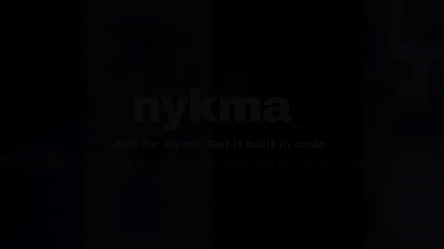
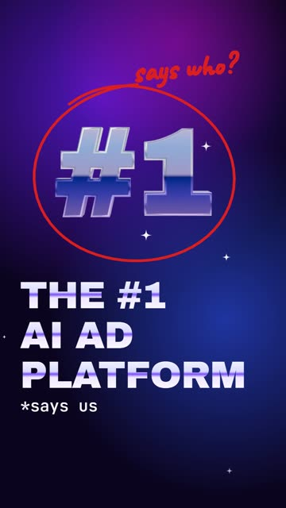
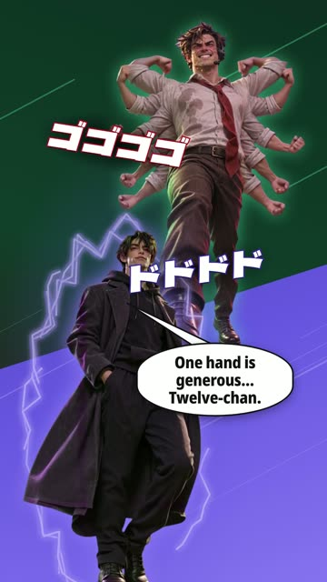
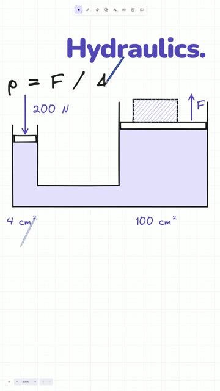
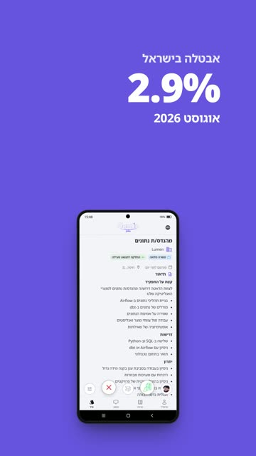

<div align="center">

# nykma_

### Ask for an ad. Get it built in code.

*nobody knows my app*: an agent that pitches, builds and renders video ads, frame by frame, on your own machine.

[](LICENSE)
[](https://claude.com/claude-code)
[](#ads-in-code)
[](#setup)
[](https://nobodyknowsmyapp.com)

<a href="docs/media/nykma-showcase.mp4"></a>

**[▶ Watch the 70-second tour](docs/media/nykma-showcase.mp4)** · every ad in it was pitched, built and rendered by nykma

</div>

---

You describe the ad. nykma's agent reads your brand, comes up with an idea and pitches it with a free slideshow animatic. When you say go, it builds the ad in React, checks its own stills, and hands you MP4s in every ratio you asked for, with post copy for each platform. Then you open the **desk**, a video editor in your browser, and change anything: move a word, retime an entrance, drop in a caption, reorder the scenes, or just tell the agent what you want.

Nothing is published unless you post it, and no money is spent without your go-ahead. Ads can be in English or Hebrew, right to left included.

## What it makes

<table>
<tr>
<td></td>
<td></td>
<td></td>
<td></td>
<td></td>
<td></td>
</tr>
<tr align="center">
<td><sub>parody testimonial</sub></td>
<td><sub>manga, generated shots</sub></td>
<td><sub>handwriting, traced</sub></td>
<td><sub>live action, generated</sub></td>
<td><sub>a lesson on the board</sub></td>
<td><sub>the real app, live</sub></td>
</tr>
</table>

## Features

**An agent with taste, and stops where you decide**
- **Brand kits, once.** Point it at a repo, a website or a folder of files. It writes `brands/<brand>/` (colours, fonts, logos, voice, what the product really does) and every ad reuses it.
- **Pitch first.** Two lines, a rough storyboard and a free animatic. Say *go*, give notes, or ask for *another idea*, before anything is spent.
- **First look, then checks.** It renders every ratio and stops. A fresh reviewer agent and free validators (layout, safe areas, contrast, brand, claims, copy, handwriting) run when you ask.
- **Hand-off.** `queue/<date>-<brand>-<slug>/` gets the MP4s, a silent copy, the sound, a cover image and `post.md`, with a caption per platform and UTM links.

<a id="ads-in-code"></a>**Ads in code**
- **A frame-exact engine.** Every value is a function of the frame, so a render comes out the same twice, and the browser preview is the render.
- **Every ratio laid out for its shape.** 16:9, 1:1 and 9:16, each composed for itself rather than shrunk.
- **Real product UI.** The app is rebuilt from its source or a live screenshot, so what the ad shows is what the product does.
- **A parts bin.** Captions, cursors, typing, rough sketches, 3D (three.js), camera moves, handwriting traced from a font stroke by stroke, green-screen inserts on footage.
- **Media when the idea needs it.** ElevenLabs voices and music, Whisper word timing, Blender plates, free stock (Pexels, Pixabay), your own footage, and generated stills and clips, locally with LTX or through a paid model, always within the budget you approve.

**The desk: a video editor for code**
- **Viewer.** The whole video in story order, in every ratio side by side, played by the engine with its sound.
- **Inspector.** Click anything to edit its text, size, colour, position or effects. Every change is written back into the ad's code, and the history can undo any of it.
- **Layers.** Every element on the frame, with a thumbnail, including what's hidden behind a veil or too small to click.
- **Add.** Drag in a heading, text, a label or a box that already wears the ad's font and colours, or the ad's own ready-made pieces with their own parameters.
- **Drag, resize, snap.** Snap to the frame, the safe areas and the other elements. Hold Ctrl to place freely.
- **Effects.** Entrances, loops and exits per element, and transitions between scenes.
- **Timeline.** Scrub, reorder, trim, and drop in your own images and clips.
- **Agent chat.** Ask for anything with the element or the frame you're on attached.
- **Publishing.** Post or schedule to your connected accounts, only when you say so.

## Setup

You need [bun](https://bun.sh), Node 22, ffmpeg on your PATH and [Claude Code](https://claude.com/claude-code).

```bash
bun install && bunx playwright install chromium
bun run dev          # the desk, at http://localhost:5173/
```

Optional, for ElevenLabs audio, Whisper word times, downloading the brand's own videos (yt-dlp), and Blender:

```bash
py -3.13 -m venv .venv && .venv/Scripts/python -m pip install -r py/requirements.txt
```

The desk's **Settings** page connects paid services (an OpenRouter key for generated video and images, and ElevenLabs), keeping the keys outside the repo. It also sets the defaults for new ads: layouts, pitch first, the ElevenLabs voice (or automatic), Whisper or ElevenLabs for word times, and how Claude Code runs. It shows what's installed and connected, and its **Agent instructions** section edits what the agent is told, for every brand or for one.

`.env.example` lists two settings, `ELEVENLABS_API_KEY` and `BLENDER`. Both are optional.

- **ElevenLabs key:** copy `.env.example` to `.env.local` and paste the key in, or run `npx -y @elevenlabs/cli@latest onboard init`. `.env.local` is gitignored. ElevenLabs output needs a paid plan for commercial use.
- **Blender:** found through `BLENDER` (the environment, then `.env.local`, then `.env`), then `PATH`, then the newest install in `C:\Program Files\Blender Foundation\` or `%LOCALAPPDATA%\Programs\`.
- **Local video:** `bun run local:setup` installs ComfyUI with LTX-2.5 in `~/nykma-local` (Windows, NVIDIA).

A fresh clone works without any of them. `gen/` is gitignored, so `py-demo` has no length until you run `mv.py build py-demo`, and needs `mv.py blender` for its plates. Every other ad works as it is.

## The flow

Write a brief in the desk's box, or in Claude Code, inside this folder:

```
> use the ad-agent to make an ad about X for <brand>
```

1. **Brand.** The first time, point the agent at what you have: a repo, a URL, screenshots, a logo. It saves `brands/<brand>/` once and reuses it.
2. **Pitch.** You get the idea in two lines, a rough storyboard and a free slideshow animatic at `queue/<date>-<brand>-<slug>/`. The agent stops there. Say "go", give notes, or say "another idea". Skip this with "no pitch, just build it".
3. **Build.** The agent builds in `src/ads/<slug>/` and checks its own stills.
4. **First look.** The agent renders every ratio, gives you the MP4s and stops, before any checks run. Give notes for another round, or say "check it", "skip the checks" or "drop it". Skip this with "just finish it".
5. **Checks.** If you ask for them, the reviewer suggests adjustments on stills and the validators check the final renders.
6. **Hand-off.** `queue/<date>-<brand>-<slug>/` holds the renders, `README.md` with what to check, and `post.md` with a caption per platform and UTM links.

Send notes in chat, or change it yourself on the desk. The agent fixes and re-renders in the same folder.

**Your ads stay yours.** A new ad's folders and its line in `src/ads/local.ts` are gitignored, so nothing you make is committed or published with nykma's code.

## Desk shortcuts

| Keys | What it does |
|---|---|
| `Space` | Play and pause |
| `←` / `→` (`Shift`: 10 frames) | Step a frame |
| `↑` / `↓` | Previous and next scene |
| `Home` / `End` | Start and end of the video |
| `V` | Select elements in the viewer |
| Click again on the selection | Select what's behind it (right click lists everything there) |
| `Delete` | Remove the selected element from the code |
| `Esc`, or a click beside the video | Deselect, or cancel a drag |
| `Ctrl` while dragging | Place freely, without snapping |
| `Ctrl+Z`, `Ctrl+Shift+Z` | Undo and redo, across code, knobs and the timeline |
| `Ctrl+Enter` | Send the brief |

## Commands

| Command | What it does | Writes |
|---|---|---|
| `bun run dev` | Opens the desk at `/`: ask for an ad, watch every ratio, edit it, answer the agent | |
| `bun run animatic <slug> [--ratio 9x16]` | Slideshow of the pitch: free, takes seconds | `queue/<date>-<brand>-<slug>/animatic.mp4` |
| `bun run stills <id> --frames 0,90 [--ratio all]` | PNGs of frames | `out/<slug>/stills/` |
| `bun run sheet <id>` | Contact sheet | `out/<slug>/<id>-sheet.png` |
| `bun run render <id> [--ratio all] [--pages 4]` | Final MP4, mixed to -14 LUFS, plus a silent copy and the sound as an MP3. `--pages` sets how many pages capture side by side | `out/<slug>/<id>.mp4`, `<id>-silent.mp4`, `<slug>[-<take>].mp3` |
| `bun run review <slug> [--frames 240,412] [--dry-run]` | Fresh reviewer per ratio on stills. Spends tokens: about $0.25 a ratio on a 30 s ad of 20 picked frames. `--frames 240` limits it to those frames and adds a recheck to the report, `--frames +240` adds them to the pick, `--dry-run` only shows the picked frames | `queue/<date>-<brand>-<slug>/review.md` |
| `bun run validate <id> [--brand <brand>]` | Free checks on renders, sound, layout, brand, truth, copy and handwriting. Exits 1 on failure. `--brand` names the kit when the queue folder doesn't | `queue/<date>-<brand>-<slug>/validate.md`, or `out/<slug>/` with no queue folder |
| `bun run hand <slug> [--force]`, `bun run hand:check <slug>` | Trace handwriting (cached, `--force` redoes it), and check its stroke order | `src/ads/<slug>/hand.gen.json`, `out/<slug>/hand-check.*` |
| `bun run brand-check <brand>` | Re-hash the brand's sources and list what changed | `brands/<brand>/sources.txt`, new hashes only |
| `.venv/Scripts/python py/mv.py build <slug> [--estimate] [--test-line]` | ElevenLabs audio, mix and timeline. `--estimate` shows the credits, `--test-line` makes one voice line to hear first | `public/ads/<slug>/gen/` |
| `.venv/Scripts/python py/mv.py blender <slug> --scene <file>` | Blender stills (`--preview --frames 1,300`), plates (`--layer`) or a 3D cut (`--video`). `--ratio 1x1` or `9x16` renders that shape | `out/<slug>/blender/`, `public/ads/<slug>/gen/blender/` |

A failure in Render, Layout or Brand that's the idea rather than a mistake gets a `Deliberate: layout 120-300 <why>` line in the queue README, and `validate` then shows it as a warning with that reason.

The animatic speaks through Windows `System.Speech` or macOS `say`. With no Hebrew voice installed, Hebrew lines stay silent, are timed from their word count and appear on screen. To hear them, install a Hebrew voice that `System.Speech` can see. Windows' own speech packs often aren't visible to it.

## Where things live

| Path | What |
|---|---|
| `.claude/agents/` | The ad agent, the concept explorers, the reviewer and the claims checker |
| `src/engine/` | Frame-accurate React engine and capture API |
| `src/parts/` | The parts bin: reuse, copy, change or ignore |
| `src/desk/` | The desk: dashboard, viewer, timeline, inspector, layers, chat |
| `src/ads/<slug>/` | One folder per ad. The examples are in `src/registry.ts`; your own go in `src/ads/local.ts` |
| `brands/<brand>/` | Saved brand kit. `brands/_template/` shows the format. Fonts must be licensed for video, and `brand.md` records each licence |
| `public/` | What the page can read: shared fonts and sfx, and `public/ads/<slug>/` for each ad, including the brand files it uses, copied from the kit. Builds don't copy it, so plates under `gen/` don't slow them |
| `queue/<date>-<brand>-<slug>/` | Pitches and hand-offs. `queue/_template/` shows the format |
| `out/` | Scratch renders and stills, gitignored |

`spec.md` has the reasoning, and `CHANGELOG.md` what changed and why.

## Licence

Free for personal and noncommercial use under the [PolyForm Noncommercial License 1.0.0](LICENSE). Every company needs a paid commercial licence: see [COMMERCIAL.md](COMMERCIAL.md) or [nobodyknowsmyapp.com/pricing](https://nobodyknowsmyapp.com/pricing). Contributions are welcome under [CONTRIBUTING.md](CONTRIBUTING.md).
